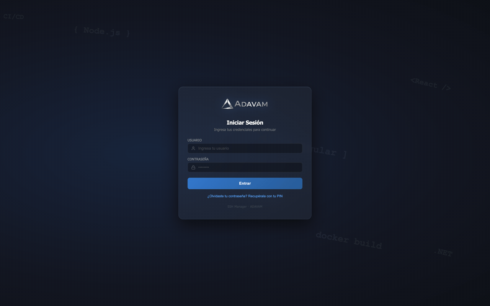
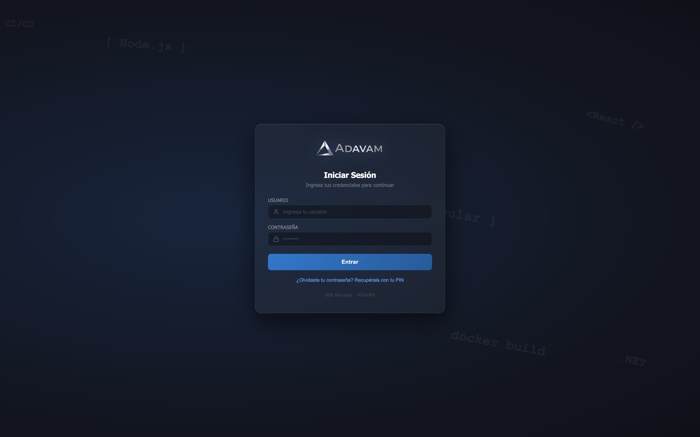
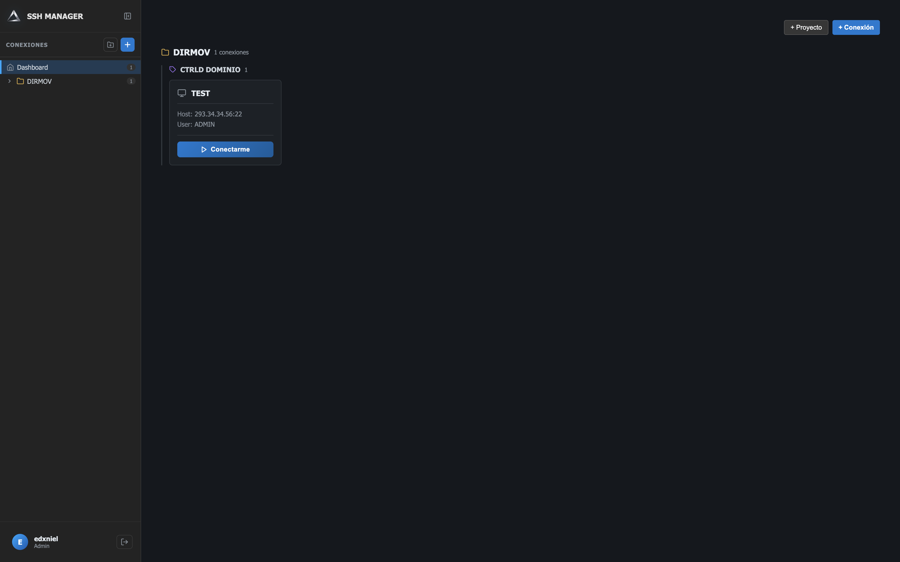
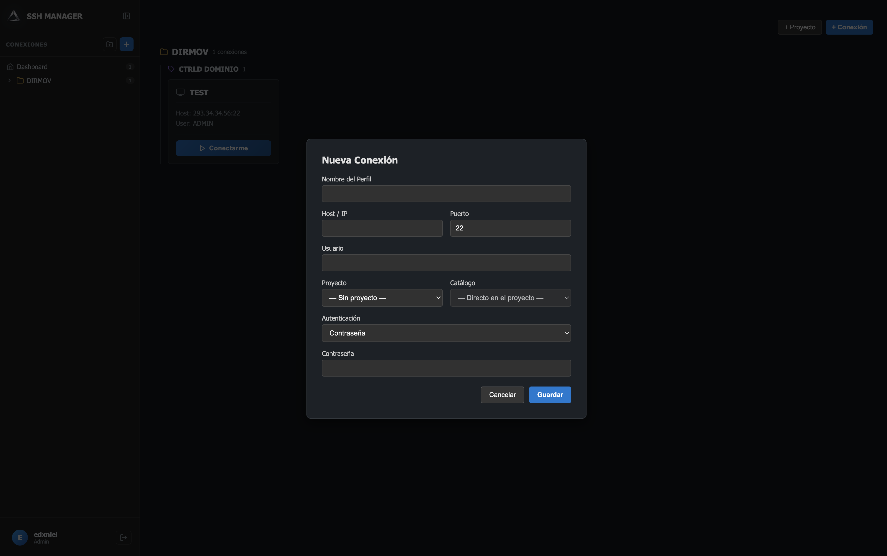
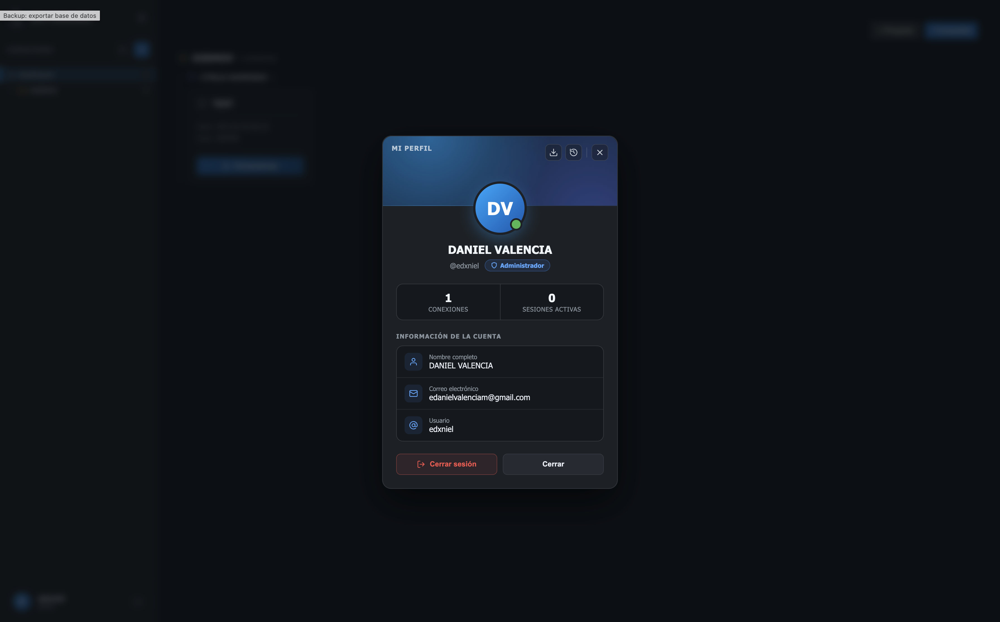
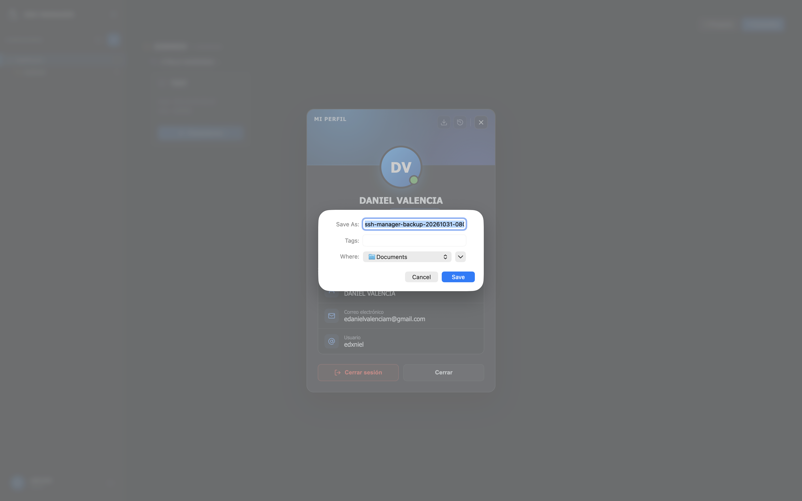
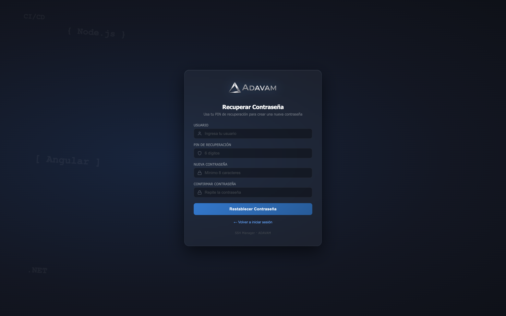

<p align="center">
  
</p>

<h1 align="center">SSH Manager — ADAVAM</h1>

<p align="center">
  Aplicación de escritorio para gestionar y administrar conexiones SSH de forma segura, con terminal integrada y base de datos local.
</p>

<p align="center">
  
  
  
  
  
  
</p>

---

## 📑 Índice

1. [Capturas de pantalla](#-capturas-de-pantalla)
2. [Características](#-características)
3. [Versiones](#-versiones)
4. [Instalación y uso](#-instalación-y-uso)
5. [Estructura del proyecto](#-estructura-del-proyecto)
6. [Arquitectura: cómo viaja una petición](#-arquitectura-cómo-viaja-una-petición)
7. [Base de datos SQLite](#️-base-de-datos-sqlite)
8. [Configuración](#-configuración)
9. [Escritorio remoto (VNC por túnel SSH) — guía de implementación](#️-escritorio-remoto-vnc-por-túnel-ssh--guía-de-implementación)
10. [Seguridad](#-seguridad)
11. [Solución de problemas frecuentes](#️-solución-de-problemas-frecuentes)
12. [Glosario para juniors](#-glosario-para-juniors)
13. [Licencia](#-licencia)

---

## 📸 Capturas de Pantalla

<p align="center">
  
</p>

<details>
<summary><b>🖼️ Ver todas las capturas</b></summary>
<br />

| Login | Dashboard |
|:-----:|:---------:|
|  |  |
| **Conexión** | **Perfil y respaldo** |
|  |  |
| **Respaldo y restauración** | **Recuperación de cuenta** |
|  |  |

</details>

---

## ✨ Características

- 🔐 **Autenticación segura** con bcryptjs (hash de contraseñas) y recuperación por PIN
- 🗄️ **Base de datos local** SQLite — sin servidores externos
- 💻 **Terminal SSH integrada** con xterm.js y node-pty
- 🧩 **Gestión de conexiones** — agregar, editar, eliminar
- 🗂️ **Agrupación** de conexiones en proyectos y catálogos
- 🔑 **Soporte de autenticación** por contraseña o llave privada SSH
- 💾 **Respaldo y restauración** de la base de datos
- ⏱️ **Cierre por inactividad**
- 📦 **Instaladores nativos** para Windows (`.exe`) y macOS (`.dmg`) con electron-builder
- 🖥️ **Escritorio remoto VNC por túnel SSH** — *en desarrollo, ver [la guía](#️-escritorio-remoto-vnc-por-túnel-ssh--guía-de-implementación)*

---

## 📦 Versiones

Versiones instaladas en el proyecto (`npm ls --depth=0`, octubre 2026).

### Entorno

| Tecnología | Versión |
|------------|---------|
| Node.js | 24.15.0 (mínimo 20.x) |
| npm | 11.x (`packageManager`: 11.12.1) |
| Angular (core) | 22.1.5 |
| Angular CLI / build | 22.1.7 |
| Electron | 44.2.0 |
| electron-builder | 26.15.3 |
| TypeScript | 6.0.3 |

### Dependencias principales

| Paquete | Versión | Uso |
|---------|---------|-----|
| `better-sqlite3` | 13.0.3 | Base de datos SQLite local |
| `bcryptjs` | 3.0.3 | Hash seguro de contraseñas |
| `node-pty` | 1.1.0 | Lanza el proceso `ssh` en una pseudoterminal |
| `@xterm/xterm` | 6.0.0 | Dibuja la terminal en la UI |
| `@xterm/addon-fit` | 0.11.0 | Ajusta la terminal al tamaño del contenedor |
| `rxjs` | 7.8.2 | Eventos IPC como `Observable` |
| `concurrently` | 10.0.5 | Ejecuta Angular + Electron en paralelo |
| `wait-on` | 9.1.0 | Espera a que Angular esté listo antes de abrir Electron |
| `vitest` | 4.1.11 | Pruebas unitarias |

### Dependencias para el escritorio remoto (por instalar)

| Paquete | Versión | Uso |
|---------|---------|-----|
| `@novnc/novnc` | 1.7.0 | Cliente VNC que dibuja la pantalla remota en un `<canvas>` |
| `ws` | 8.22.1 | Servidor WebSocket en el proceso main (puente hacia VNC) |

---

## 🚀 Instalación y Uso

### Prerrequisitos

- **Node.js** ≥ 20.x — [nodejs.org](https://nodejs.org)
- **npm** 11.x (incluido con Node.js)
- **Cliente `ssh`** del sistema (incluido en macOS, Linux y Windows 10+)
- **Herramientas de compilación nativa** (las necesitan `node-pty` y `better-sqlite3`):
  - **Windows:** [Visual Studio Build Tools](https://visualstudio.microsoft.com/downloads/) con **Desarrollo de escritorio con C++**
  - **macOS:** `xcode-select --install`

### 1. Clonar el repositorio

```bash
git clone https://github.com/tu-usuario/ssh-manager.git
cd ssh-manager
```

### 2. Instalar dependencias

```bash
npm install
```

### 3. Modo desarrollo

Inicia Angular (puerto 4050) y Electron en paralelo con hot-reload:

```bash
npm start
```

> La app detecta automáticamente si hay usuarios en la DB.
> - **Sin usuarios** → muestra el formulario de registro
> - **Con usuarios** → muestra el formulario de login

### 4. Generar instalador

```bash
npm run electron:build
```

Genera `SSH Manager-Setup-<versión>.exe` en Windows o `SSH Manager <versión>.dmg` en macOS, dentro de `dist/`.

### Scripts disponibles

| Script | Qué hace |
|--------|----------|
| `npm start` | Angular en `localhost:4050` + Electron |
| `npm run build` | Compila Angular a `dist/ssh-manager/browser` |
| `npm run watch` | Compila Angular en modo desarrollo al guardar |
| `npm run electron:build` | Compila Angular y genera el instalador |
| `npm test` | Ejecuta las pruebas |

---

## 📁 Estructura del Proyecto

El proyecto tiene dos mitades:

- **`electron/`** — el **proceso main** (Node.js). Tiene acceso al sistema: archivos, procesos, base de datos, red.
- **`src/app/`** — el **proceso renderer** (Angular). Solo interfaz; pide todo al main por IPC.

```
system-management-terminal-ssh/
├── main.js                         # Punto de entrada de Electron: crea el contenedor y la ventana
├── package.json                    # Dependencias, scripts y config de electron-builder
├── angular.json                    # Configuración de Angular CLI
├── build/                          # Licencia y script NSIS del instalador de Windows
├── public/                         # Logos, favicon e imágenes del README
│
├── electron/                       # ===== PROCESO MAIN (Node) =====
│   ├── config.js                   # Constantes centralizadas (puertos, rutas, tamaños)
│   ├── container.js                # Crea todos los servicios e inyecta sus dependencias
│   ├── window.js                   # Ventana principal (BrowserWindow)
│   ├── database/
│   │   ├── database.js             # Abre SQLite y aplica migraciones
│   │   └── schema.js               # CREATE TABLE + lista de MIGRATIONS
│   ├── repositories/               # SQL puro: una clase por tabla
│   │   ├── user.repository.js
│   │   ├── project.repository.js
│   │   ├── catalog.repository.js
│   │   └── connection.repository.js
│   ├── services/                   # Lógica de negocio (no conocen Electron)
│   │   ├── auth.service.js         # Registro, login, recuperación
│   │   ├── grouping.service.js     # Proyectos y catálogos
│   │   ├── connection.service.js   # CRUD de conexiones
│   │   ├── ssh-session.service.js  # Terminal SSH con node-pty
│   │   └── backup.service.js       # Respaldo y restauración
│   ├── ipc/                        # Conecta canales IPC con servicios
│   │   ├── channels.js             # Nombres de canales (fuente de verdad)
│   │   ├── index.js                # Registra todos los handlers
│   │   └── *.handlers.js           # Un archivo por área (auth, terminal, backup…)
│   └── utils/                      # Validadores y utilidades de tiempo
│
└── src/
    ├── index.html / main.ts / styles.css
    └── app/                        # ===== PROCESO RENDERER (Angular) =====
        ├── app.ts / app.html / app.css   # Pantalla principal (sidebar + pestañas de terminal)
        ├── login/                  # Pantalla de login / registro / recuperación
        └── core/
            ├── ipc/
            │   ├── ipc-channels.ts # Copia de channels.js para TypeScript
            │   └── ipc.service.ts  # Único acceso a ipcRenderer
            ├── models/             # Interfaces (Connection, User, Group…)
            ├── services/           # Un servicio Angular por área (ssh, auth, backup…)
            └── utils/              # Árbol de conexiones, validadores, storage
```

> **Regla de oro:** Angular nunca toca el sistema directamente. Todo lo que abre procesos, puertos o archivos vive en `electron/` y Angular lo pide por IPC.

---

## 🧭 Arquitectura: cómo viaja una petición

Cada petición pasa por cuatro capas, siempre en el mismo orden. Ejemplo real: abrir una terminal SSH.

```
 Angular                         IPC                       Electron (main)
┌──────────────────────┐   invoke('start-ssh')   ┌───────────────────────────┐
│ SshService.start()   │ ──────────────────────► │ terminal.handlers.js      │
│ (core/services)      │                         │   └► SshSessionService    │
│                      │ ◄────────────────────── │        └► ConnectionService│
│ incomingData$ (on)   │  send('terminal.        │             └► Connection- │
└──────────────────────┘   incomingData')        │                Repository  │
                                                 └───────────────────────────┘
```

| Capa | Dónde vive | Qué hace | Ejemplo (terminal) |
|------|-----------|----------|--------------------|
| 1. Repositorio | `electron/repositories/` | Solo SQL contra SQLite | `ConnectionRepository.findById()` |
| 2. Servicio | `electron/services/` | Lógica; no importa Electron | `SshSessionService.start()` lanza `ssh` con node-pty |
| 3. Handler IPC | `electron/ipc/*.handlers.js` | Une un canal con un servicio | `ipcMain.handle('start-ssh', …)` |
| 4. Servicio Angular | `src/app/core/services/` | Llama al canal con `IpcService` | `SshService.start(id, cols, rows)` |

Conceptos clave:

- **`electron/container.js`** crea cada servicio y le pasa lo que necesita (inyección de dependencias). Ningún servicio hace `new` de otro.
- **`channels.js` e `ipc-channels.ts`** deben tener **exactamente** los mismos nombres. Si no coinciden, el mensaje se pierde sin error.
- **`invoke`** pide algo y espera respuesta (`ipcMain.handle`). **`send`** envía sin esperar (`ipcMain.on`). **`on`** escucha eventos que el main manda con `mainWindow.send`.

---

## 🗄️ Base de Datos SQLite

La base de datos se crea automáticamente en la carpeta de datos del usuario (`app.getPath('userData')`):

```
Windows: C:\Users\<usuario>\AppData\Roaming\ssh-manager\ssh-manager.db
macOS:   ~/Library/Application Support/ssh-manager/ssh-manager.db
```

Las tablas se definen en `electron/database/schema.js`. Los cambios de columnas se hacen **solo agregando** sentencias al final de `MIGRATIONS`; nunca se editan las anteriores.

#### Tabla `users`
| Campo | Tipo | Descripción |
|-------|------|-------------|
| `id` | TEXT (PK) | UUID |
| `username` | TEXT UNIQUE | Nombre de usuario |
| `name` | TEXT | Nombre |
| `lastname` | TEXT | Apellido |
| `email` | TEXT UNIQUE | Correo electrónico |
| `password` | TEXT | Hash bcrypt de la contraseña |
| `recovery_pin` | TEXT | PIN de recuperación de cuenta |

#### Tabla `projects`
| Campo | Tipo | Descripción |
|-------|------|-------------|
| `id` | TEXT (PK) | UUID |
| `name` | TEXT | Nombre del proyecto |

#### Tabla `catalogs`
| Campo | Tipo | Descripción |
|-------|------|-------------|
| `id` | TEXT (PK) | UUID |
| `project_id` | TEXT | Proyecto al que pertenece |
| `name` | TEXT | Nombre del catálogo |

#### Tabla `connections`
| Campo | Tipo | Descripción |
|-------|------|-------------|
| `id` | TEXT (PK) | UUID |
| `name` | TEXT | Nombre del perfil |
| `host` | TEXT | IP o hostname del servidor |
| `port` | INTEGER | Puerto SSH (default: 22) |
| `username` | TEXT | Usuario SSH |
| `auth_type` | TEXT | `password` o `key` |
| `password` | TEXT | Contraseña (opcional) |
| `key_path` | TEXT | Ruta a llave privada SSH (opcional) |
| `project_id` | TEXT | Proyecto (opcional) |
| `catalog_id` | TEXT | Catálogo (opcional) |
| `vnc_port` | INTEGER | *Por agregar* — puerto VNC remoto (default: 5900) |
| `vnc_password` | TEXT | *Por agregar* — contraseña VNC (opcional) |

---

## 🔧 Configuración

### Constantes del proceso main (`electron/config.js`)

| Constante | Valor | Uso |
|-----------|-------|-----|
| `DEV_SERVER_URL` | `http://localhost:4050` | URL de Angular en desarrollo |
| `WINDOW_SIZE` | 1200 × 800 | Tamaño inicial de la ventana |
| `DB_FILE_NAME` | `ssh-manager.db` | Nombre del archivo SQLite |
| `BCRYPT_ROUNDS` | 10 | Costo del hash de contraseñas |
| `MIN_PASSWORD_LENGTH` | 8 | Largo mínimo de contraseña |
| `DEFAULT_SSH_PORT` | 22 | Puerto SSH por defecto |
| `DEFAULT_TERMINAL_SIZE` | 80 × 30 | Columnas × filas iniciales |

### electron-builder (`package.json` → `build`)

```json
"build": {
  "appId": "com.ssh-manager.app",
  "productName": "SSH Manager",
  "mac": { "target": ["dmg"], "icon": "public/logo-single.png" },
  "win": { "icon": "public/logo-single.png" },
  "nsis": { "oneClick": false, "allowToChangeInstallationDirectory": true }
}
```

### Angular (`angular.json`) — Presupuestos de bundle

```json
"budgets": [
  { "type": "initial", "maximumWarning": "1MB",  "maximumError": "1.5MB" },
  { "type": "anyComponentStyle", "maximumWarning": "10kB", "maximumError": "15kB" }
]
```

---

## 🖥️ Escritorio remoto (VNC por túnel SSH) — guía de implementación

> **Estado: en desarrollo.** Esta sección es la guía para construir la funcionalidad. Los archivos marcados como *nuevo* todavía no existen en el repositorio.

### ¿Qué vamos a construir?

Un botón **"Escritorio remoto"** en cada conexión guardada que abre una pestaña con la pantalla del otro equipo, con mouse y teclado. Usa el mismo host, usuario y contraseña o llave que ya guarda SSH Manager.

### ¿Por qué VNC por túnel SSH y no algo tipo RustDesk?

| Opción | Qué necesita el equipo remoto | Esfuerzo | Cuándo conviene |
|--------|-------------------------------|----------|-----------------|
| **VNC por túnel SSH + noVNC** ✅ | SSH + servidor VNC | Bajo-medio | Ya llegamos al equipo por SSH (LAN, VPN o puerto 22) |
| Cliente externo (RDP / `vnc://`) | RDP o VNC | Muy bajo | Algo rápido, pero se ve fuera de la app |
| Estilo RustDesk (P2P, atraviesa NAT) | Un agente propio instalado | Alto (semanas) | Equipos detrás de NAT sin SSH |

Elegimos la primera porque:

- **No abre puertos nuevos.** El VNC remoto solo escucha en `localhost`; el único puerto expuesto sigue siendo el 22.
- **Todo va cifrado** por SSH (VNC por sí solo cifra mal).
- **Poco código** y sin servidores propios.

**Limitación:** igual que la terminal, el equipo remoto debe ser alcanzable por SSH.

### Cómo funciona

```
┌───────────────────────── SSH Manager (tu equipo) ─────────────────────────┐
│                                                                           │
│  Angular (renderer)              Electron (main)                          │
│  ┌──────────────────┐  WS   ┌──────────────────┐  TCP  ┌──────────────┐   │
│  │ RemoteDesktop-   │──────►│ VncBridgeService │──────►│ ssh -N -L    │   │
│  │ Component        │       │ ws://127.0.0.1:  │       │ 127.0.0.1:   │   │
│  │ (<canvas> noVNC) │◄──────│ <puerto>?token=  │◄──────│ <libre>      │   │
│  └──────────────────┘       └──────────────────┘       └──────┬───────┘   │
│                                                               │           │
└───────────────────────────────────────────────────────────────┼───────────┘
                                         túnel cifrado, puerto 22│
┌──────────────────────── Equipo remoto ────────────────────────┼───────────┐
│                                   sshd ◄──────────────────────┘           │
│                                    │                                      │
│                                    └──► servidor VNC en 127.0.0.1:5900    │
└───────────────────────────────────────────────────────────────────────────┘
```

1. Angular llama a `remote:start` con el id de la conexión.
2. `SshTunnelService` lanza `ssh -N -L 127.0.0.1:<libre>:127.0.0.1:5900 usuario@host` y espera a que el puerto local responda.
3. `VncBridgeService` abre un servidor WebSocket local con un token aleatorio que reenvía todo al puerto del túnel.
4. Angular recibe la URL `ws://…` y noVNC dibuja la pantalla remota.

¿Por qué hace falta el puente? noVNC corre dentro del navegador (renderer) y **solo habla WebSocket**; el servidor VNC habla **TCP**. El puente traduce entre los dos.

### Archivos que se tocan

| Archivo | Acción |
|---------|--------|
| `electron/config.js` | Cambia — 2 constantes |
| `electron/database/schema.js` | Cambia — 2 migraciones |
| `electron/repositories/connection.repository.js` | Cambia — columnas VNC en INSERT/UPDATE |
| `electron/services/connection.service.js` | Cambia — valores por defecto VNC |
| `electron/services/ssh-tunnel.service.js` | **Nuevo** |
| `electron/services/vnc-bridge.service.js` | **Nuevo** |
| `electron/ipc/channels.js` + `src/app/core/ipc/ipc-channels.ts` | Cambian — 4 canales |
| `electron/ipc/remote-desktop.handlers.js` | **Nuevo** |
| `electron/ipc/index.js`, `electron/container.js`, `main.js` | Cambian — registro y limpieza |
| `src/types/novnc.d.ts` | **Nuevo** |
| `src/app/core/models/connection.model.ts` | Cambia — campos VNC |
| `src/app/core/services/remote-desktop.service.ts` | **Nuevo** |
| `src/app/remote-desktop/remote-desktop.component.ts` | **Nuevo** |
| `src/app/app.ts` / `app.html` | Cambian — botón y pestaña |

---

### Parte A — Configurar el equipo remoto

El equipo que vamos a ver necesita **un servidor SSH que permita túneles** y **un servidor VNC en el puerto 5900**, idealmente escuchando solo en `localhost`.

#### A.1 Permitir túneles en SSH (todos los sistemas)

En `/etc/ssh/sshd_config` (Windows: `C:\ProgramData\ssh\sshd_config`) confirma esta línea y reinicia el servicio SSH:

```text
AllowTcpForwarding yes
```

#### A.2 macOS

1. Ajustes del Sistema → General → Compartir → activa **Sesión remota** (SSH).
2. En la misma pantalla activa **Compartir pantalla**.
3. Pulsa la ⓘ de Compartir pantalla → activa *"Los visualizadores VNC pueden controlar la pantalla con contraseña"* y define una contraseña (máximo 8 caracteres).
4. macOS escucha en todas las interfaces: bloquea el puerto 5900 en el firewall de la red y conéctate siempre por el túnel.

#### A.3 Linux (sesión X11)

```bash
sudo apt install x11vnc            # Debian/Ubuntu
x11vnc -storepasswd                # guarda la contraseña en ~/.vnc/passwd
x11vnc -display :0 -localhost -rfbauth ~/.vnc/passwd -forever -shared
```

- `-localhost` = solo acepta conexiones del propio equipo (las que llegan por el túnel).
- Si el escritorio usa **Wayland**, x11vnc no funciona: usa `wayvnc` (Sway/Hyprland) o elige la sesión "Xorg" en la pantalla de login.
- Servidor sin pantalla física: TigerVNC con `vncserver :1 -localhost yes` (escucha en el puerto 5901; guarda `vnc_port = 5901`).

#### A.4 Windows 10/11

1. Instala OpenSSH Server (PowerShell como administrador):

   ```powershell
   Add-WindowsCapability -Online -Name OpenSSH.Server~~~~0.0.1.0
   Start-Service sshd
   Set-Service -Name sshd -StartupType Automatic
   ```

2. Instala **TightVNC Server** y define una contraseña.
3. En TightVNC → Configuración → Acceso: marca *"Allow loopback connections"* y *"Allow only loopback connections"*.

#### A.5 Comprobar antes de programar

Desde tu equipo, valida que el remoto responde por el túnel con cualquier cliente VNC:

```bash
ssh -N -L 5901:localhost:5900 usuario@IP_REMOTA
# en otra terminal (macOS):
open vnc://localhost:5901
```

Si ves la pantalla, el equipo remoto está listo.

---

### Parte B — Implementación paso a paso

Primero el backend (pasos 1–6), que se puede probar solo; después Angular (pasos 7–9). **Haz un commit por paso.**

#### Paso 1. Instalar dependencias

```bash
npm install @novnc/novnc@1.7.0 ws@8.22.1
```

#### Paso 2. Configuración — `electron/config.js`

Agrega dentro del `Object.freeze({ … })`:

```js
  DEFAULT_VNC_PORT: 5900,
  TUNNEL_READY_TIMEOUT_MS: 15000,
```

#### Paso 3. Base de datos

En `electron/database/schema.js`, agrega al **final** del arreglo `MIGRATIONS`:

```js
  `ALTER TABLE connections ADD COLUMN vnc_port INTEGER DEFAULT 5900;`,
  `ALTER TABLE connections ADD COLUMN vnc_password TEXT;`,
```

En `electron/repositories/connection.repository.js` agrega las columnas al `INSERT` y al `UPDATE`:

```js
  create(conn) {
    this.db.prepare(`
      INSERT INTO connections (id, name, host, port, username, auth_type, password, key_path,
                               project_id, catalog_id, vnc_port, vnc_password)
      VALUES (@id, @name, @host, @port, @username, @auth_type, @password, @key_path,
              @project_id, @catalog_id, @vnc_port, @vnc_password)
    `).run(conn);
  }

  update(conn) {
    return this.db.prepare(`
      UPDATE connections
      SET name = @name, host = @host, port = @port, username = @username, auth_type = @auth_type,
          password = @password, key_path = @key_path, project_id = @project_id, catalog_id = @catalog_id,
          vnc_port = @vnc_port, vnc_password = @vnc_password
      WHERE id = @id
    `).run(conn).changes;
  }
```

> ⚠️ better-sqlite3 lanza **`Missing named parameter`** si el objeto no trae alguna llave. En `ConnectionService`, antes de llamar al repositorio, completa los valores por defecto:
>
> ```js
> const data = { ...conn, vnc_port: conn.vnc_port ?? 5900, vnc_password: conn.vnc_password ?? null };
> ```

#### Paso 4. Servicio del túnel — `electron/services/ssh-tunnel.service.js` (nuevo)

Lanza `ssh -N -L` (túnel sin terminal) con node-pty, igual que la terminal, para reutilizar el auto-responder que acepta el fingerprint y escribe la contraseña.

```js
const net = require('net');
const pty = require('node-pty');
const config = require('../config');

/** Abre un túnel SSH por conexión: 127.0.0.1:<libre> → remoto:127.0.0.1:<vnc_port> */
class SshTunnelService {
  constructor({ connectionService, sshSessionService, onExit }) {
    this.connectionService = connectionService;
    this.ssh = sshSessionService; // reutilizamos buildSshArgs, sshBinary y createAutoResponder
    this.onExit = onExit;
    this.tunnels = new Map(); // connectionId → { proc, localPort }
  }

  async open(connectionId) {
    const existing = this.tunnels.get(connectionId);
    if (existing) return existing.localPort;

    const conn = this.connectionService.getById(connectionId);
    if (!conn) throw new Error('Conexión no encontrada');

    const localPort = await getFreePort();
    const remotePort = conn.vnc_port || config.DEFAULT_VNC_PORT;
    const args = [
      '-N',                                              // no abrir shell
      '-L', `127.0.0.1:${localPort}:127.0.0.1:${remotePort}`,
      '-o', 'ExitOnForwardFailure=yes',                  // si el túnel falla, ssh termina
      '-o', 'ServerAliveInterval=30',                    // detecta conexiones muertas
      ...this.ssh.buildSshArgs(conn),                    // -i, -p y usuario@host (siempre al final)
    ];

    const proc = pty.spawn(this.ssh.sshBinary(), args, {
      name: 'xterm', cols: 80, rows: 24,
      cwd: process.env.HOME || process.env.USERPROFILE,
      env: process.env,
      useConpty: false,
    });
    this.tunnels.set(connectionId, { proc, localPort });
    proc.onData(this.ssh.createAutoResponder(conn, proc));
    proc.onExit(({ exitCode }) => {
      if (this.tunnels.get(connectionId)?.proc !== proc) return; // se cerró a mano
      this.tunnels.delete(connectionId);
      this.onExit(connectionId, exitCode);
    });

    try {
      await waitForPort(localPort, config.TUNNEL_READY_TIMEOUT_MS,
        () => this.tunnels.get(connectionId)?.proc === proc);
    } catch (err) {
      this.close(connectionId);
      throw err;
    }
    return localPort;
  }

  close(connectionId) {
    const tunnel = this.tunnels.get(connectionId);
    if (!tunnel) return true;
    this.tunnels.delete(connectionId);
    try { tunnel.proc.kill(); } catch { /* ya terminó */ }
    return true;
  }

  closeAll() {
    for (const id of [...this.tunnels.keys()]) this.close(id);
    return true;
  }
}

/** Pide al sistema un puerto libre (puerto 0) y lo libera */
function getFreePort() {
  return new Promise((resolve, reject) => {
    const srv = net.createServer();
    srv.on('error', reject);
    srv.listen(0, '127.0.0.1', () => {
      const { port } = srv.address();
      srv.close(() => resolve(port));
    });
  });
}

/** Reintenta conectar al puerto local hasta que ssh lo abra (= ya autenticó) */
function waitForPort(port, timeoutMs, isAlive) {
  const deadline = Date.now() + timeoutMs;
  return new Promise((resolve, reject) => {
    const attempt = () => {
      if (!isAlive()) return reject(new Error('SSH terminó: revisa usuario, contraseña o AllowTcpForwarding'));
      const sock = net.connect(port, '127.0.0.1');
      sock.once('connect', () => { sock.destroy(); resolve(); });
      sock.once('error', () => {
        sock.destroy();
        if (Date.now() > deadline) reject(new Error('El túnel SSH no respondió a tiempo'));
        else setTimeout(attempt, 300);
      });
    };
    attempt();
  });
}

module.exports = { SshTunnelService };
```

#### Paso 5. Puente WebSocket ↔ TCP — `electron/services/vnc-bridge.service.js` (nuevo)

Cada sesión tiene su propio puerto y un **token aleatorio** para que ningún otro programa del equipo pueda conectarse al puente.

```js
const crypto = require('crypto');
const net = require('net');
const { WebSocketServer } = require('ws');

class VncBridgeService {
  constructor() {
    this.bridges = new Map(); // connectionId → WebSocketServer
  }

  /** @returns {Promise<string>} URL ws:// que usará noVNC */
  open(connectionId, tcpPort) {
    this.close(connectionId);
    const token = crypto.randomBytes(24).toString('hex');

    return new Promise((resolve, reject) => {
      const wss = new WebSocketServer({
        host: '127.0.0.1',
        port: 0, // puerto libre
        verifyClient: ({ req }) => new URL(req.url, 'http://localhost').searchParams.get('token') === token,
        handleProtocols: protocols => (protocols.has('binary') ? 'binary' : false),
      });

      wss.on('connection', ws => {
        const tcp = net.connect(tcpPort, '127.0.0.1');
        const end = () => { tcp.destroy(); ws.terminate(); };
        ws.on('message', data => { if (!tcp.destroyed) tcp.write(data); });
        tcp.on('data', chunk => { if (ws.readyState === ws.OPEN) ws.send(chunk); });
        ws.on('close', end);
        ws.on('error', end);
        tcp.on('close', end);
        tcp.on('error', end);
      });

      wss.once('listening', () => {
        this.bridges.set(connectionId, wss);
        resolve(`ws://127.0.0.1:${wss.address().port}/?token=${token}`);
      });
      wss.once('error', reject);
    });
  }

  close(connectionId) {
    const wss = this.bridges.get(connectionId);
    if (!wss) return;
    this.bridges.delete(connectionId);
    for (const client of wss.clients) client.terminate();
    wss.close();
  }

  closeAll() {
    for (const id of [...this.bridges.keys()]) this.close(id);
  }
}

module.exports = { VncBridgeService };
```

#### Paso 6. IPC, contenedor y limpieza

**6.1 Canales** — agrégalos en `electron/ipc/channels.js` **y**, con el mismo texto, en `src/app/core/ipc/ipc-channels.ts`:

```js
  REMOTE_START: 'remote:start',
  REMOTE_STOP: 'remote:stop',
  REMOTE_STOP_ALL: 'remote:stop-all',
  REMOTE_EXIT: 'remote:exit',
```

**6.2 Handlers** — `electron/ipc/remote-desktop.handlers.js` (nuevo):

```js
const CH = require('./channels');

function registerRemoteDesktopHandlers(ipcMain, { connectionService, sshTunnelService, vncBridgeService }) {
  ipcMain.handle(CH.REMOTE_START, async (_e, connectionId) => {
    const localPort = await sshTunnelService.open(connectionId);
    try {
      const wsUrl = await vncBridgeService.open(connectionId, localPort);
      const conn = connectionService.getById(connectionId);
      return { wsUrl, vncPassword: conn.vnc_password || '' };
    } catch (err) {
      sshTunnelService.close(connectionId);
      throw err;
    }
  });

  ipcMain.handle(CH.REMOTE_STOP, (_e, connectionId) => {
    vncBridgeService.close(connectionId);
    return sshTunnelService.close(connectionId);
  });

  ipcMain.handle(CH.REMOTE_STOP_ALL, () => {
    vncBridgeService.closeAll();
    return sshTunnelService.closeAll();
  });
}

module.exports = { registerRemoteDesktopHandlers };
```

Regístralo en `electron/ipc/index.js` junto a los demás:

```js
const { registerRemoteDesktopHandlers } = require('./remote-desktop.handlers');
// …dentro de registerIpcHandlers:
registerRemoteDesktopHandlers(ipcMain, container);
```

**6.3 Contenedor** — en `electron/container.js`, después de crear `sshSessionService`:

```js
const { SshTunnelService } = require('./services/ssh-tunnel.service');
const { VncBridgeService } = require('./services/vnc-bridge.service');

// …dentro de createContainer, después de sshSessionService:
const vncBridgeService = new VncBridgeService();
const sshTunnelService = new SshTunnelService({
  connectionService,
  sshSessionService,
  onExit: (id, exitCode) => {
    vncBridgeService.close(id);
    mainWindow.send(CH.REMOTE_EXIT, { id, exitCode });
  },
});

// y agrégalos al objeto que se devuelve:
return {
  app, mainWindow, database,
  authService, groupingService, connectionService, backupService, sshSessionService,
  sshTunnelService, vncBridgeService,
};
```

**6.4 Limpieza al salir** — en `main.js`, para no dejar procesos `ssh` vivos:

```js
app.on('before-quit', () => {
  container.vncBridgeService.closeAll();
  container.sshTunnelService.closeAll();
});
```

**Prueba del backend:** con `npm start` abierto, desde DevTools de la ventana (Ctrl/Cmd+Shift+I) ejecuta:

```js
await require('electron').ipcRenderer.invoke('remote:start', '<id-de-una-conexión>')
// → { wsUrl: 'ws://127.0.0.1:5xxxx/?token=…', vncPassword: '…' }
```

#### Paso 7. Tipos y servicio Angular

noVNC no trae tipos de TypeScript. Crea `src/types/novnc.d.ts`:

```ts
declare module '@novnc/novnc';
```

En `src/app/core/models/connection.model.ts` agrega a la interfaz `Connection`:

```ts
  vnc_port?: number;
  vnc_password?: string | null;
```

Crea `src/app/core/services/remote-desktop.service.ts`, con el mismo estilo que `ssh.service.ts`:

```ts
import { Injectable } from '@angular/core';
import { Observable } from 'rxjs';
import { IpcService } from '../ipc/ipc.service';
import { IpcChannels } from '../ipc/ipc-channels';

export interface RemoteSession { wsUrl: string; vncPassword: string; }
export interface RemoteExit { id: string; exitCode: number; }

/** Canal de comunicación con los túneles VNC del proceso principal */
@Injectable({ providedIn: 'root' })
export class RemoteDesktopService {
  readonly exit$: Observable<RemoteExit>;

  constructor(private ipc: IpcService) {
    this.exit$ = ipc.on<RemoteExit>(IpcChannels.REMOTE_EXIT);
  }

  start(connectionId: string): Promise<RemoteSession> {
    return this.ipc.invoke<RemoteSession>(IpcChannels.REMOTE_START, connectionId);
  }

  stop(connectionId: string): Promise<boolean> {
    return this.ipc.invoke<boolean>(IpcChannels.REMOTE_STOP, connectionId);
  }

  stopAll(): Promise<boolean> {
    return this.ipc.invoke<boolean>(IpcChannels.REMOTE_STOP_ALL);
  }
}
```

#### Paso 8. Componente — `src/app/remote-desktop/remote-desktop.component.ts` (nuevo)

```ts
import { AfterViewInit, Component, DestroyRef, ElementRef, OnDestroy,
         inject, input, signal, viewChild } from '@angular/core';
import { takeUntilDestroyed } from '@angular/core/rxjs-interop';
import RFB from '@novnc/novnc';
import { RemoteDesktopService } from '../core/services/remote-desktop.service';

@Component({
  selector: 'app-remote-desktop',
  template: `
    <div class="rd-toolbar">
      <span>{{ status() }}</span>
      <button type="button" (click)="sendCtrlAltDel()">Ctrl+Alt+Supr</button>
      <button type="button" (click)="disconnect()">Desconectar</button>
    </div>
    <div #screen class="rd-screen"></div>
  `,
  styles: [`
    :host { display: flex; flex-direction: column; height: 100%; }
    .rd-toolbar { display: flex; gap: 8px; align-items: center; padding: 6px; }
    .rd-screen { flex: 1; background: #000; overflow: hidden; }
  `],
})
export class RemoteDesktopComponent implements AfterViewInit, OnDestroy {
  readonly connectionId = input.required<string>();
  readonly status = signal('Conectando…');

  private readonly screen = viewChild.required<ElementRef<HTMLDivElement>>('screen');
  private readonly remote = inject(RemoteDesktopService);
  private rfb: any = null;

  constructor() {
    // Si el túnel SSH se cae, lo mostramos en pantalla
    this.remote.exit$
      .pipe(takeUntilDestroyed(inject(DestroyRef)))
      .subscribe(({ id }) => {
        if (id === this.connectionId()) this.status.set('El túnel SSH se cerró');
      });
  }

  async ngAfterViewInit() {
    try {
      const { wsUrl, vncPassword } = await this.remote.start(this.connectionId());
      this.rfb = new RFB(this.screen().nativeElement, wsUrl, {
        wsProtocols: ['binary'],
        credentials: { password: vncPassword },
      });
      this.rfb.scaleViewport = true;   // ajusta la pantalla remota al tamaño de la pestaña
      this.rfb.resizeSession = false;  // no cambia la resolución del equipo remoto
      this.rfb.addEventListener('connect', () => this.status.set('Conectado'));
      this.rfb.addEventListener('disconnect', (e: any) =>
        this.status.set(e.detail.clean ? 'Desconectado' : 'Se perdió la conexión'));
      this.rfb.addEventListener('credentialsrequired', () =>
        this.status.set('Falta la contraseña VNC: edítala en la conexión'));
      this.rfb.addEventListener('securityfailure', () =>
        this.status.set('Contraseña VNC incorrecta'));
    } catch (err) {
      this.status.set('Error: ' + (err instanceof Error ? err.message : String(err)));
    }
  }

  sendCtrlAltDel() {
    this.rfb?.sendCtrlAltDel();
  }

  disconnect() {
    this.rfb?.disconnect();
    this.rfb = null;
    this.remote.stop(this.connectionId());
  }

  ngOnDestroy() {
    this.disconnect();
  }
}
```

> No uses `prompt()` para pedir la contraseña: Electron no lo soporta y devuelve `null`.

#### Paso 9. Conectarlo a la pantalla principal (`app.ts` / `app.html`)

1. Importa `RemoteDesktopComponent` en el arreglo `imports` del componente `App`.
2. En el menú de cada conexión del sidebar agrega un botón **"Escritorio remoto"** que abra una pestaña de tipo `'remote'` (las de terminal serán `'ssh'`).
3. Donde hoy se pintan los `terminal-container`, pinta el componente para las pestañas remotas:

   ```html
   @if (tab.type === 'remote') {
     <app-remote-desktop [connectionId]="tab.connectionId" />
   }
   ```

4. En el formulario de conexión agrega los campos **"Puerto VNC"** (número, 5900 por defecto) y **"Contraseña VNC"**.
5. Igual que con `closeAll()` de la terminal, llama a `remoteDesktopService.stopAll()` al arrancar la app para cerrar túneles huérfanos tras recargar la ventana.

---

### Parte C — Pruebas

| # | Prueba | Resultado esperado |
|---|--------|--------------------|
| 1 | Abrir escritorio remoto con datos correctos | Estado "Conectado" y se ve la pantalla |
| 2 | Contraseña SSH incorrecta | "SSH terminó: revisa usuario, contraseña…" en menos de 15 s |
| 3 | VNC apagado en el remoto | "Se perdió la conexión" |
| 4 | Contraseña VNC incorrecta | "Contraseña VNC incorrecta" |
| 5 | Cerrar la pestaña | No queda ningún proceso `ssh -N` (`ps aux \| grep "ssh -N"`) |
| 6 | Cerrar la app con sesiones abiertas | No queda ningún proceso `ssh -N` |
| 7 | Desconectar la red del remoto | En ~60 s aparece "El túnel SSH se cerró" |
| 8 | Abrir terminal y escritorio de la misma conexión | Ambos funcionan a la vez |

---

## 🔐 Seguridad

- Las contraseñas de usuario se almacenan con **bcryptjs** (salt rounds = 10).
- La base de datos SQLite es **local** y no se transmite a ningún servidor.
- Las contraseñas SSH (y VNC) se guardan en **texto plano** en SQLite — se recomienda usar **llaves SSH** en producción.
- **Escritorio remoto:**
  - El servidor VNC remoto debe escuchar **solo en `localhost`** (`-localhost`, "only loopback"). Nunca expongas el puerto 5900 a internet.
  - El túnel y el puente escuchan solo en `127.0.0.1`, nunca en `0.0.0.0`.
  - Cada puente usa un **token aleatorio** por sesión; no lo registres en logs.
  - Cierra siempre túnel y puente juntos (`REMOTE_STOP`) para no dejar puertos abiertos.
- La ventana usa `nodeIntegration: true` y `contextIsolation: false` (ver `electron/window.js`). Es una simplificación: lo recomendable a futuro es `contextIsolation: true` con un `preload.js`.

---

## 🛠️ Solución de Problemas Frecuentes

### Error `AttachConsole failed` al abrir terminal (Windows)
En Electron bajo Windows, `node-pty` puede fallar al usar ConPTY porque la app no tiene una consola nativa visible.
**Solución (ya aplicada):** `useConpty: false` en `electron/services/ssh-session.service.js` para usar el backend `winpty`. El túnel del escritorio remoto usa la misma opción.

### Demora al guardar, editar o eliminar conexiones
Las respuestas IPC llegan fuera del ciclo de detección de cambios de Angular, y la UI no se actualizaba al instante.
**Solución (ya aplicada):** `IpcService` resuelve las promesas dentro de `this.zone.run()`.

### Escritorio remoto

| Síntoma | Causa probable | Solución |
|---------|----------------|----------|
| "El túnel SSH no respondió a tiempo" | Host inalcanzable o SSH lento | Prueba `ssh usuario@host` en una terminal |
| "SSH terminó…" al instante | Contraseña/llave incorrecta o `AllowTcpForwarding no` | Revisa la Parte A.1 |
| Pantalla negra, estado "Conectando…" | Servidor VNC apagado o en otro puerto | Revisa `vnc_port`; en Linux confirma que `x11vnc` sigue corriendo |
| `x11vnc` no arranca en Linux | El escritorio usa Wayland | Usa `wayvnc` o la sesión "Xorg" |
| Se ve, pero no responde mouse/teclado | macOS sin permiso de control | Activa *"…pueden controlar la pantalla"* (Parte A.2) |
| `Missing named parameter "vnc_port"` | El objeto no trae los campos VNC | Defaults en `ConnectionService` (Paso 3) |
| `Cannot find module '@novnc/novnc'` en TS | Falta la declaración de tipos | Crea `src/types/novnc.d.ts` (Paso 7) |
| Muy lento | Red lenta o resolución alta | Baja la resolución remota; `rfb.qualityLevel = 4` y `rfb.compressionLevel = 6` |

---

## 📖 Glosario para juniors

| Término | Qué significa aquí |
|---------|--------------------|
| **Proceso main** | La parte de Electron que corre en Node.js (`main.js` + `electron/`). Puede abrir procesos, archivos y puertos. |
| **Proceso renderer** | La ventana donde corre Angular. Es un navegador Chromium. |
| **IPC** | *Inter-Process Communication*: mensajes entre renderer y main (`invoke`, `send`, `on`). |
| **node-pty** | Librería que lanza un programa (aquí `ssh`) como si estuviera en una terminal real. |
| **Túnel SSH (`-L`)** | Hace que un puerto de tu equipo apunte a un puerto del remoto, cifrado por SSH. |
| **`-N`** | Opción de `ssh` para no abrir shell: solo mantiene el túnel. |
| **VNC / RFB** | Protocolo para ver y controlar la pantalla de otro equipo. RFB es el nombre técnico. |
| **noVNC** | Cliente VNC escrito en JavaScript que dibuja la pantalla en un `<canvas>`. |
| **WebSocket** | Conexión bidireccional y persistente que sí puede abrir un navegador (TCP crudo no). |
| **Puente WS ↔ TCP** | Código que recibe WebSocket y reenvía los bytes a un socket TCP, y viceversa. |
| **Puerto 0** | Pedirle al sistema operativo "dame cualquier puerto libre". |
| **Inyección de dependencias** | Un servicio recibe sus colaboradores en el constructor en lugar de crearlos (`container.js`). |
| **Migración** | Sentencia SQL que actualiza la estructura de una base existente sin borrar datos. |
| **Fingerprint** | Huella del servidor SSH; la primera vez `ssh` pregunta si confías en él. |

---

## 📄 Licencia

MIT — ADAVAM © 2026
